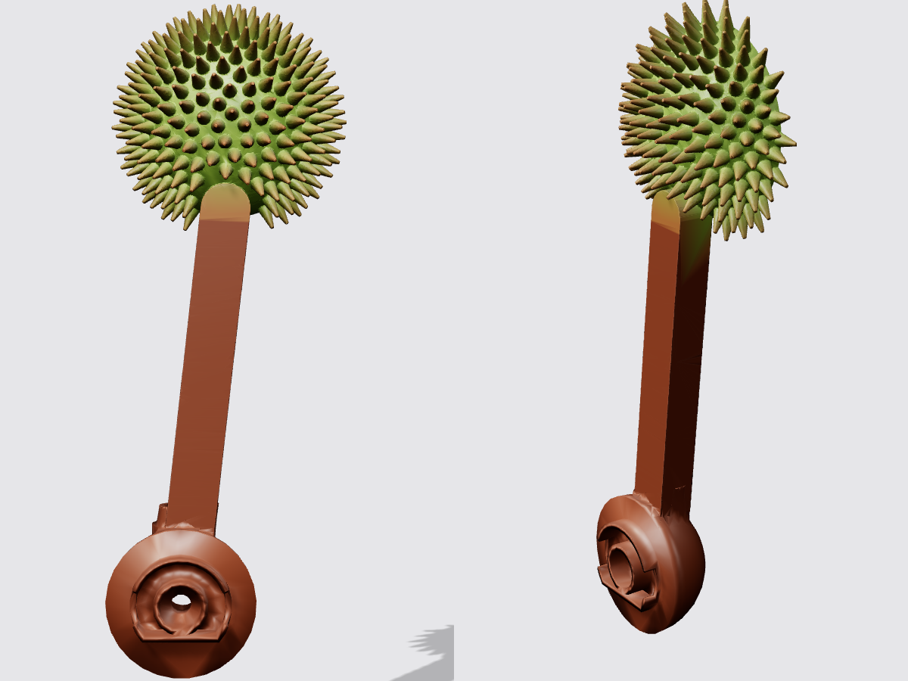
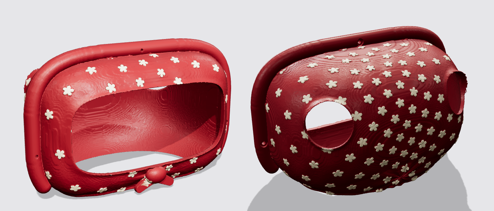

## 🌰 Castanyada skin aka "Reachy Castanyer"


A roasted-chestnut skin for **La Castanyada**, the Catalan autumn festivity celebrated on the night of 31 October / 1 November with *castanyes torrades* (roasted chestnuts), *moniatos* (sweet potatoes) and *panellets*.

The body becomes a big glossy chestnut, with the classic roasting cross cut opened on the front to show the golden flesh. The antennas are brown stems ending in a spiky chestnut burr (*eriçó*), still closed, like it hangs on the tree. On the head, Reachy wears the flowery headscarf (*mocador*) of the *castanyera*, the chestnut seller, knotted under the chin.

<br clear="left">

> [!NOTE]
> The image above is a **render, not a photo**. The head in it is a simplified stand-in for the real one, and the antenna position is approximate. This skin was designed digitally from the fit of the official pumpkin and Christmas tree shells, and **it hasn't been test-printed yet**. Before you print the full body, check the fit on your robot (see step 1).

### Parts

All files are in [`stl/`](stl).

| File | Qty | Suggested filament | Notes |
|---|---|---|---|
| `Chestnut_body_front.stl` | 1 | Brown | Front half with the roasting cross cut |
| `Chestnut_body_back.stl` | 1 | Brown | Back half |
| `Burr_antenna_L.stl` / `Burr_antenna_R.stl` | 1 each | Brown (green burr painted) | Replace the antennas, same mount as the bat wings of the pumpkin skin |
| `Headscarf_front.stl` | 1 | Red or black | Front half: frames the face, with the knot under the chin |
| `Headscarf_back.stl` | 1 | Red or black | Back half: top, sides and back of the head |
| `Chestnut_tip.stl` | 1 | Brown | *Optional*, instead of the headscarf: a small chestnut tip for the top of the bare head (same base as the pumpkin stem) |

You will also need:
- 6 [pins 3mm x 16mm](../pumpkin/README.md#steps-to-make-it) (the same ones as the pumpkin and Christmas tree skins)
- 3 self-tapping screws 2.5mm x 6mm for the headscarf (the same ones as the Christmas tree head)
- Thin double-sided tape, only if you use the chestnut tip

### Steps to make it

1. **Check the fit first**
   The body halves have the same inner shape, front/back split and pin positions as the official Christmas tree skin, and near the head they stay inside the outline of the pumpkin skin. Before you spend a full spool, print a thin test slice: in your slicer, cut the back half to keep only the bottom 15 to 20 mm, then check it slides over the robot base without forcing.

2. **3D print the parts**
   - Body halves: print them standing on the flat split face, with supports where your slicer asks for them. Low infill (10 to 15%) is enough and keeps the parts light.
   - Burr antennas: print them like the pumpkin bat wings, lying on their flat back. The burr is a dome with a flat back, so it doesn't need supports; the round antenna mount may. The spikes are small and blunt (about 1.5 mm wide at the base), so print them with a 0.4 mm nozzle or smaller and a slow outer wall.
   - Headscarf halves: print each one standing on its flat split face, with supports. The small flowers on the scarf are in relief (0.6 mm) to make painting them easier, so a 0.2 mm layer height or finer keeps them crisp.
   - Chestnut tip (optional): print it upright with supports under the curved base.

   You can print the chestnut parts in brown filament and the headscarf in red or black, then only paint the details.

3. **Paint the parts**
   If you printed in white, or want more detail, we suggest:
   - **Chestnut shell** (body and tip): Nut brown, RAL 8011, gloss or satin. A gloss varnish makes it shine like a real chestnut.
   - **Base scar** (the rough band at the bottom, below the small groove): Beige, RAL 1001, matte
   - **Inside of the cross cut** (the chestnut flesh): Sand yellow, RAL 1002
   - **Roasted look**: dry-brush a little dark brown or black along the curled lips of the cut
   - **Antenna stems**: the same nut brown as the body
   - **Burrs**: Yellow green, RAL 6018, or a slightly darker green. Dry-brush the spike tips in light brown, so they look like a burr just starting to ripen.
   - **Headscarf**: Ruby red, RAL 3003, or black, as many castanyeres wear it. Paint the flowers in cream (RAL 9001) with a small yellow dot in the middle.
   - **Tuft** of the chestnut tip: beige or off-white

4. **Insert the pins**
   Each half has 6 holes, 3.2 mm wide and 8.5 mm deep, on the split face. Press the pins into one half (a drop of glue keeps them in place), then snap the two halves together around the robot body.

5. **Assemble everything**
   - Snap the body halves together around Reachy Mini.
   - Fit the burr antennas the same way as the pumpkin bat wings: `Burr_antenna_L` goes where `L_bat_ear_low` goes, and `Burr_antenna_R` where `R_bat_ear_low` goes.
   - Fit the headscarf like the Christmas tree head cover. Take the antennas off first: the back half slides on from behind, and the antenna mounts can't pass sideways through the antenna openings. Place the front half over the face, then slide the back half on from behind. From the back, push the 3 screws through the holes in the back half's folded edge (one on top, one on each side) and screw them into the front half. Then put the antennas back on.
   - If you prefer the bare head, stick the chestnut tip on top of the head with thin double-sided tape instead. Don't paint or glue anything directly on the robot.

6. **Change the antennas motors configuration** (safety)
   The burr antennas weigh about the same as the bat wings (about 9.5 cm³ of plastic against 9 cm³), but the burr is round and wider. The headscarf is 3 to 4 mm thick on the head, and its folded edge sticks out up to 11 mm on the top and sides. Before running any app, move the head and the antennas slowly through their full range and check that nothing rubs. If you want to make them move safely, you can [change the configuration of the antennas motors in the configuration file](https://github.com/pollen-robotics/reachy_mini/blob/1c347437881846b4ea3f293838baf11323c3e536/src/reachy_mini/assets/config/hardware_config.yaml#L144-L145), especially the limits of the motors position, to avoid any collision between the burrs and the head or body.






### Editing the design

The STL files are generated by the Python scripts in [`tools/`](tools). The scripts reuse the official pumpkin and Christmas tree STLs from this repository for the fit to the robot, so run them from the repository root:

```bash
pip install numpy scipy scikit-image trimesh manifold3d pillow
python castanyada/tools/make_body.py         # body halves, about 4 minutes
python castanyada/tools/make_accessories.py  # burr antennas and chestnut tip
python castanyada/tools/make_head.py         # headscarf halves, about 5 minutes
```

Parameters such as the chestnut silhouette, the size of the cross cut, the pin and screw positions, or the size of the face opening are listed at the top of each script. The headscarf takes the shape of the head from the inside of the Christmas tree head cover.

Bona Castanyada! 🍂
