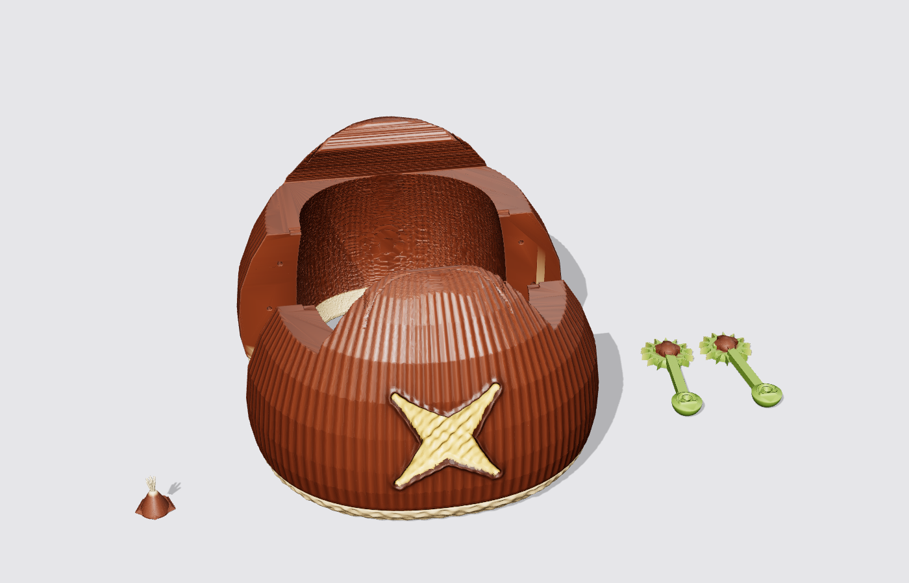

## 🌰 Castanyada skin aka "Reachy Castanyer"


A roasted-chestnut skin for **La Castanyada**, the Catalan autumn festivity celebrated on the night of 31 October / 1 November with *castanyes torrades* (roasted chestnuts), *moniatos* (sweet potatoes) and *panellets*.

The body becomes a big glossy chestnut, with the classic roasting cross cut opened on the front to show the golden flesh. The antennas are chestnut burrs (*eriçons*) split open with a chestnut inside, and a small chestnut tip with its tuft sits on top of the head.

<br clear="left">

> [!NOTE]
> The image above is a **render, not a photo**. The head in it is a simplified stand-in for the real one. This skin was designed digitally from the fit of the official pumpkin and Christmas tree shells, and **it hasn't been test-printed yet**. Before you print the full body, check the fit on your robot (see step 1).

### Parts

All files are in [`stl/`](stl).

| File | Qty | Suggested filament | Notes |
|---|---|---|---|
| `Chestnut_body_front.stl` | 1 | Brown | Front half with the roasting cross cut |
| `Chestnut_body_back.stl` | 1 | Brown | Back half |
| `Burr_antenna_L.stl` / `Burr_antenna_R.stl` | 1 each | Green | Replace the antennas, same mount as the bat wings of the pumpkin skin |
| `Chestnut_tip.stl` | 1 | Brown | Goes on top of the head, same base as the pumpkin stem |

You will also need:
- 6 [pins 3mm x 16mm](../pumpkin/README.md#steps-to-make-it) (the same ones as the pumpkin and Christmas tree skins)
- Thin double-sided tape for the chestnut tip

### Steps to make it

1. **Check the fit first**
   The body halves have the same inner shape, front/back split and pin positions as the official Christmas tree skin, and near the head they stay inside the outline of the pumpkin skin. Before you spend a full spool, print a thin test slice: in your slicer, cut the back half to keep only the bottom 15 to 20 mm, then check it slides over the robot base without forcing.

2. **3D print the parts**
   - Body halves: print them standing on the flat split face, with supports where your slicer asks for them. Low infill (10 to 15%) is enough and keeps the parts light.
   - Burr antennas: print them like the pumpkin bat wings, lying on their flat back. The spikes don't need supports; the round antenna mount may.
   - Chestnut tip: print it upright with supports under the curved base.

   You can print directly in brown and green filament to reduce painting.

3. **Paint the parts**
   If you printed in white, or want more detail, we suggest:
   - **Chestnut shell** (body and tip): Nut brown, RAL 8011, gloss or satin. A gloss varnish makes it shine like a real chestnut.
   - **Base scar** (the rough band at the bottom, below the small groove): Beige, RAL 1001, matte
   - **Inside of the cross cut** (the chestnut flesh): Sand yellow, RAL 1002
   - **Roasted look**: dry-brush a little dark brown or black along the curled lips of the cut
   - **Burrs**: Yellow green, RAL 6018, with the spike tips dry-brushed in pale yellow. Paint the chestnut inside the burr nut brown.
   - **Tuft** of the chestnut tip: beige or off-white

4. **Insert the pins**
   Each half has 6 holes, 3.2 mm wide and 8.5 mm deep, on the split face. Press the pins into one half (a drop of glue keeps them in place), then snap the two halves together around the robot body.

5. **Assemble everything**
   - Snap the body halves together around Reachy Mini.
   - Fit the burr antennas the same way as the pumpkin bat wings: `Burr_antenna_L` goes where `L_bat_ear_low` goes, and `Burr_antenna_R` where `R_bat_ear_low` goes.
   - Stick the chestnut tip on top of the head with thin double-sided tape. Don't paint or glue anything directly on the robot.

6. **Change the antennas motors configuration** (safety)
   The burrs weigh about the same as the bat wings, but they are round and wider. If you want to make them move safely, you can [change the configuration of the antennas motors in the configuration file](https://github.com/pollen-robotics/reachy_mini/blob/1c347437881846b4ea3f293838baf11323c3e536/src/reachy_mini/assets/config/hardware_config.yaml#L144-L145), especially the limits of the motors position, to avoid any collision between the burrs and the head or body.



### Editing the design

The STL files are generated by the Python scripts in [`tools/`](tools). The scripts reuse the official pumpkin and Christmas tree STLs from this repository for the fit to the robot, so run them from the repository root:

```bash
pip install numpy scipy scikit-image trimesh manifold3d pillow
python castanyada/tools/make_body.py         # body halves, about 4 minutes
python castanyada/tools/make_accessories.py  # burr antennas and chestnut tip
```

Parameters such as the chestnut silhouette, the size of the cross cut and the pin positions are listed at the top of each script.

Bona Castanyada! 🍂
